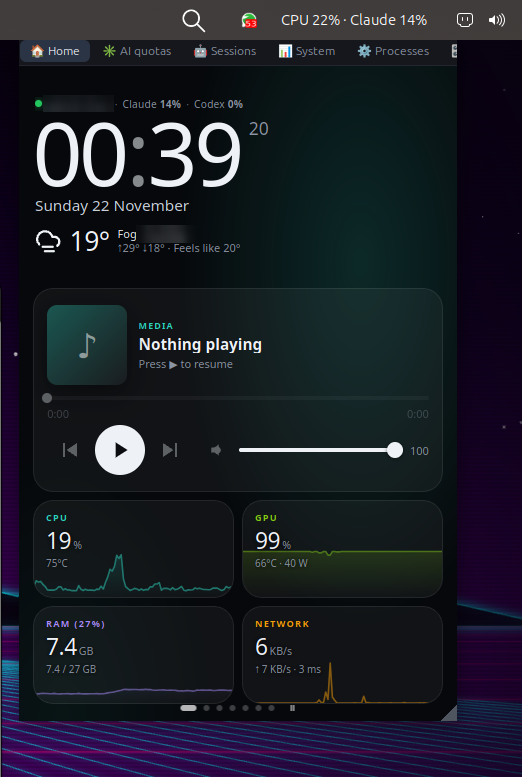

# PhoneBox for GNOME

[PhoneBox](https://github.com/ersinkoc/phonebox) on the Linux desktop: CPU and the Claude session quota in the
GNOME top bar, and the full PhoneBox panel, page tabs included, one click away.



A community add-on, not part of PhoneBox itself. It only talks to the PhoneBox agent on `127.0.0.1`; nothing
leaves the computer.

## What's inside

| Folder | What it is |
|---|---|
| [`gnome-shell-extension/`](gnome-shell-extension) | The top bar indicator. Left click shows the panel under it, right click opens the PhoneBox settings page. |
| [`gnome-widget/`](gnome-widget) | The panel: a small Python + WebKitGTK window that loads the agent's `/panel/` and adds clickable page tabs. The extension opens it as a dropdown; it also works alone as a desktop widget, on GNOME and most X11 desktops. |

## Install

Needs a running [PhoneBox agent](https://github.com/ersinkoc/phonebox#quick-start), GNOME Shell 45 or later (used on 46; 47–51 not tried yet),
and GTK 3 with WebKitGTK 4.1 for Python:

```sh
sudo apt install python3-gi gir1.2-webkit2-4.1    # Debian/Ubuntu
git clone https://github.com/Gabrielmororo180/phonebox-gnome
cd phonebox-gnome
gnome-shell-extension/install.sh                  # installs the panel and the extension
```

Then log out and back in: GNOME on Wayland only picks up a newly installed extension at login.

Only the panel, as a desktop widget: `gnome-widget/install.sh`.

## License

[MIT](LICENSE)
